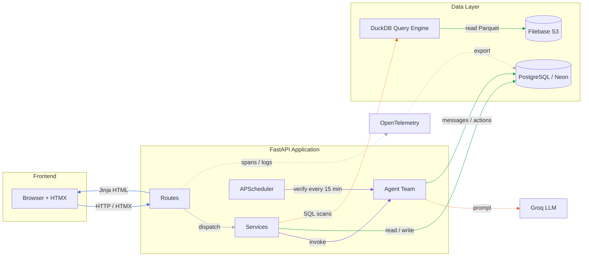
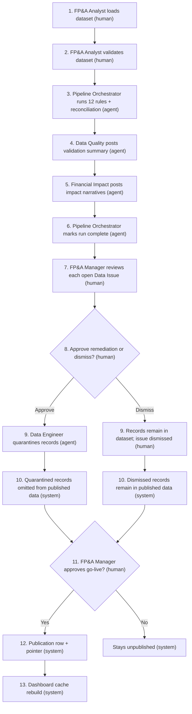

# Architecture

Browser + HTMX talk to FastAPI. Routes dispatch to services and agents. Postgres
holds state, DuckDB reads Parquet from Filebase, and OpenTelemetry writes back
to Postgres.

## Request Flow

**Footnotes**

- **Routes** (`backend/routes/`): page handlers, form actions, approval gates, and thread endpoints.
- **Frontend → Routes**: page loads, HTMX swaps, and form submits all arrive as HTTP requests.
- **Routes → Frontend**: Jinja renders the full page or an HTMX partial; that HTML is the only response path.
- **Routes → Services**: routes dispatch to services, which own the data and agent work.
- **Routes → OpenTelemetry**: every request emits a span/log; OpenTelemetry exports it to PostgreSQL / Neon.

## Stores

| Store | Holds | Notes |
|---|---|---|
| PostgreSQL / Neon | Personas, datasets, runs, validations, reconciliations, exceptions, quarantines, discussions/messages, approvals, publications, alerts, `agent_actions`, `dashboard_cache`, `otel_*` | System of record |
| DuckDB | — | In-process query engine over Parquet; no persistent state |
| Filebase S3 | `scenarios/<dataset>/*.parquet` + `manifest.json` | Immutable source bundle; env vars keep the `R2_` prefix |
| Local disk | Per-dataset Parquet cache | 800 MB cap; oldest folder evicted first; validation scans the latest 12 months |

## Pipeline

Remediation proposals are requested from Data Issues (`/exceptions/{id}`); the
pipeline does not auto-propose them.

Before scanning, the pipeline downloads the dataset into the local cache and
computes the 12-month window. It persists reconciliation rows, opens
material-gap exceptions, creates one validation exception per failed rule per
month, and closes exceptions from superseded runs. Approving a remediation
quarantines the records, so they are omitted from published data; dismissing
keeps them in the dataset, so they remain in published data. Either way, the
issue is no longer open.

## Agent Team

| Agent | Code | Trigger | Writes |
|---|---|---|---|
| Pipeline Orchestrator | `services/orchestrator.py` | Analyst clicks Validate; Controller rerun | Run status, start/finish messages, run trace |
| Data Quality | `services/dq.py` | Every pipeline run | Validation summary message + action |
| Financial Impact Agent | `teams/fa.py` | Every pipeline run | Impact narrative per open issue |
| Data Engineer | `teams/de.py` | Manager/DE request; approved remediation | Proposal, quarantine rows |
| Controller | `teams/controller.py` | APScheduler, every 15 minutes | Alerts, triage notes, revalidation runs |

## Trace Propagation

| Stage | Trace |
|---|---|
| HTTP request | FastAPI server span |
| UI-triggered pipeline | New root `pipeline.run` span in a daemon thread; `runs.trace_id` points at it |
| Controller cycle | `controller.verification_job` span; its autonomous rerun is a child |
| Agent action | `agent_actions.trace_id` |
| Thread message | `messages.trace_id` |
| Demo reset | Both audit rows share the `POST /runs/reset` trace |

A UI-triggered run is a separate trace from the click that started it: the
request returns immediately, and the pipeline runs in a background thread.

## Runtime and Offline

| Component | Runtime? | Role |
|---|---|---|
| FastAPI | Yes | Serves the app |
| Filebase `scenarios/<dataset>/*.parquet` | Yes | Source of Parquet for validation and dashboard |
| Offline generation | No | Removed after the three seeds were produced; no in-repo generator or uploader |

## Deviations

| Deviation | Reason |
|---|---|
| OTel stored in Postgres, viewed in-app | No external Grafana/Jaeger; documented non-goal |
| Persona selector instead of auth | Demo scope; documented non-goal |
| Baseline fixture retired | Generated datasets carry their own runs and publication pointers |
| Only FastAPI auto-instrumented | Telemetry volume stays inside the free Postgres tier |
| Scenarios nav hidden | Route remains for forward-looking analysis; not part of the demo path |
| Generator removed | Seeds are fixed fixtures; no in-repo generation or upload path |
| Remediation is human-triggered | The pipeline no longer auto-proposes; Manager/DE requests it from Data Issues |
| UI-triggered runs get their own trace | The request returns immediately; the pipeline runs in a daemon thread |

See [spec.md](spec.md) §4–§5 for the component contract and data flow.
