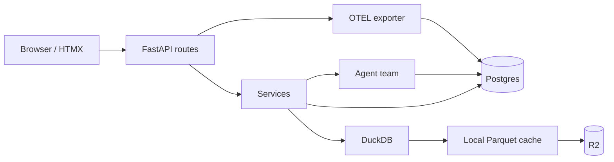
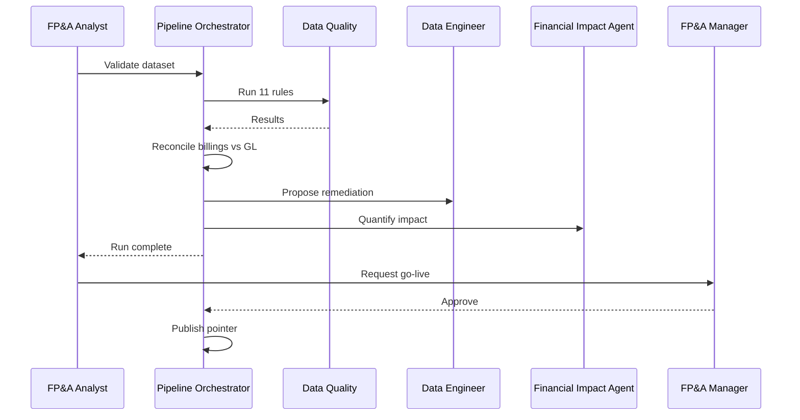

# Architecture

## Request Flow

## Stores

| Store | Holds |
|---|---|
| Postgres | Personas, datasets, runs, validations, exceptions, discussions, publications, alerts, audit, telemetry |
| DuckDB | Query engine over Parquet |
| R2 | `scenarios/<dataset>/*.parquet` + manifest |
| Local disk | Cached Parquet for the 12-month window |

## Pipeline

## Agents

| Agent | Input | Output | Executes |
|---|---|---|---|
| Pipeline Orchestrator | Run request | Start/finish messages | Pipeline |
| Data Quality | Run data | Validation summary | 11 rules |
| Data Engineer | Open data issues | Remediation proposal | Quarantine after approval |
| Financial Impact Agent | Data issue | Financial impact narrative | None |
| Controller | Published state | Alerts, triage, escalation | Revalidation on stale publication |

## Trace Propagation

| Step | Trace |
|---|---|
| HTTP request | FastAPI root span |
| Pipeline | `backend.pipeline` span |
| Agent action | `agent_actions.trace_id` |
| Thread message | `messages.trace_id` |
| Controller cycle | `controller.verification_job` span |

## Deviations

| Deviation | Reason |
|---|---|
| OTel stored in Postgres, viewed in-app | No external Grafana/Jaeger; documented non-goal |
| Persona selector instead of auth | Demo scope; documented non-goal |
| Baseline fixture retired | Generated datasets carry their own runs and publication pointers |
| Only FastAPI auto-instrumented | Telemetry volume stays inside the free Postgres tier |
| Scenarios nav hidden | Route remains for forward-looking analysis; not part of the demo path |

See [spec.md](spec.md) §4–§5 for the full data flow.
