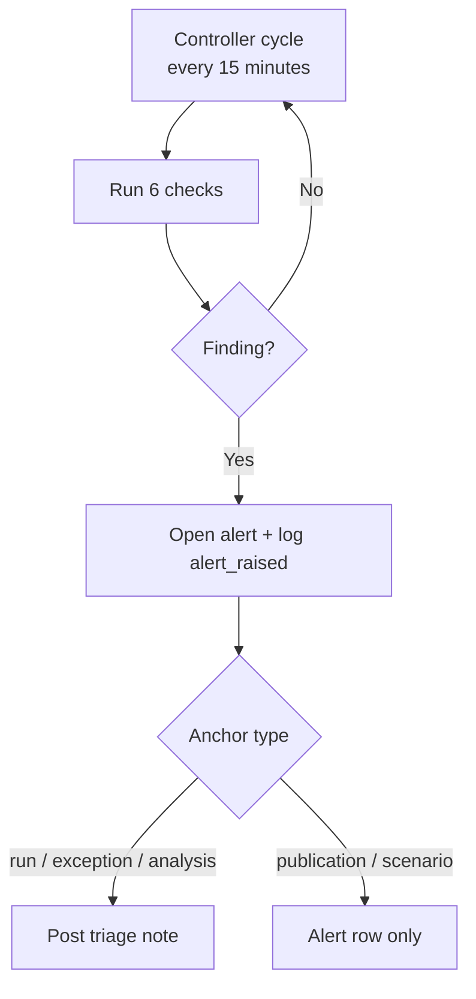

# Operating Model

## Objective

| Priority | Choice |
|---|---|
| 1 | **Timeliness** — publish data good enough to act on this month |
| 2 | **Accuracy** — bounded by tolerance, not zero variance |
| 3 | **Auditability** — every action logged, every publication human-approved |

This is an FP&A simulation, not an audit system. Waiting for perfect data is a
failure mode; acting on data outside tolerance is a different one.

## Tolerance, Not Perfection

| Control | Behavior |
|---|---|
| Validation rules | Fire when variance exceeds the configured tolerance |
| Reconciliation | Billings vs GL at `(period, account_id, item_category)`; material gaps raise exceptions |
| Data Issues | One per affected month per failed rule; the latest period stays `open` |
| Publication | Blocked while open data issues remain |

## Controller

| Responsibility | Detail |
|---|---|
| Freshness SLA | `CONTROLLER_STALE_HOURS` (default 24h) |
| Continuous verification | Six checks every `CONTROLLER_INTERVAL_MINUTES` (default 15) |
| Alerting | Six alert types; one-hour dedup; triage note on run / exception / analysis anchors |
| Autonomous action | None — alert and triage only |
| Not autonomous | No publication, approval, re-run, or financial mutation |

The Controller is the counterweight to timeliness: it enforces freshness and
surfaces drift, while publication stays FP&A Manager-gated.

## Governance

| Gate | Approver | Effect |
|---|---|---|
| Go-live | FP&A Manager | Publication row + dashboard pointer |
| Remediation | FP&A Manager | Data Engineer executes quarantine or re-run |
| Demo reset | Director of FP&A | Deletes non-baseline data; preserves audit and telemetry |

## Audit vs Current State

| Page | What it shows | Survives reset? |
|---|---|---|
| Validation (`/runs`) | Current runs and validation results | No |
| Data Issues (`/exceptions`) | Current open issue queue | No |
| Audit (`/audit`) | Append-only ledger: approvals, publications, agent actions, Controller alerts | Yes |
| Observability (`/observability`) | Traces, logs, and metrics | Yes |

Audit is history. An alert there is evidence that the Controller acted at that
time; it does not mean the issue is still open. The live queue is Data Issues.
